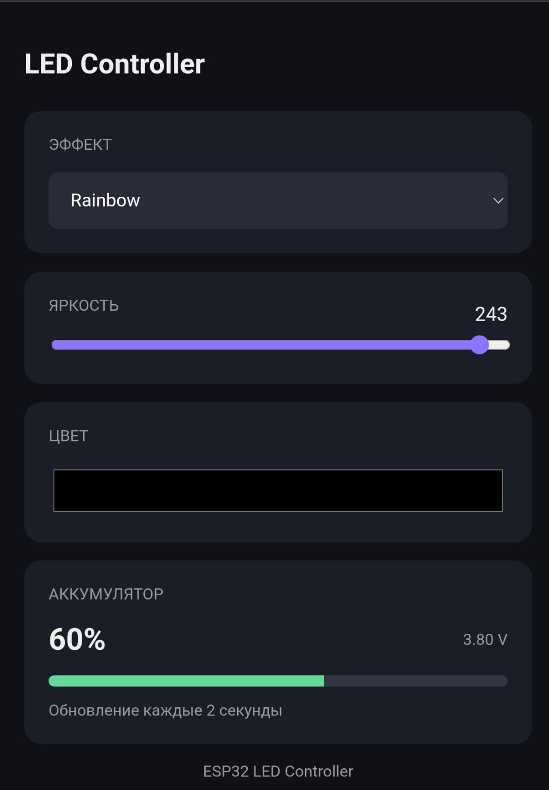
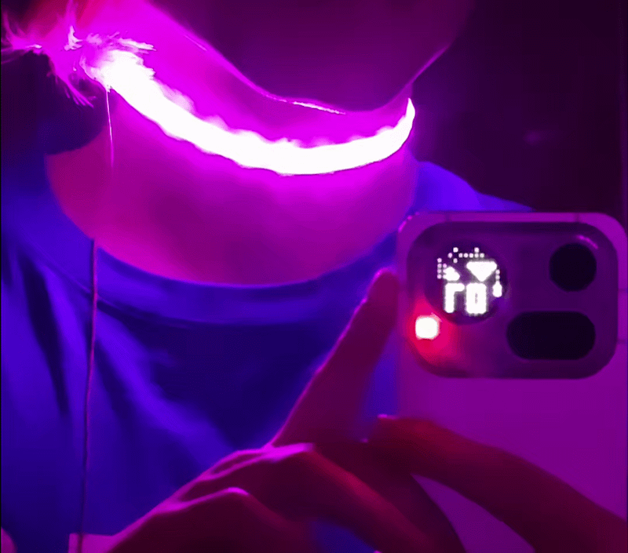
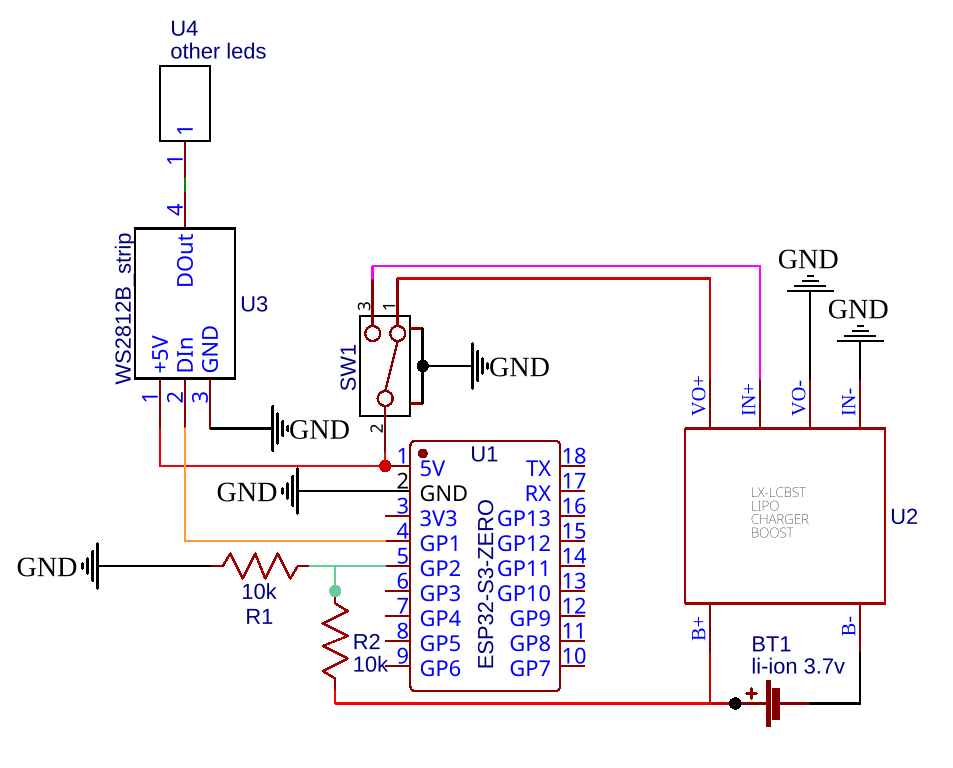
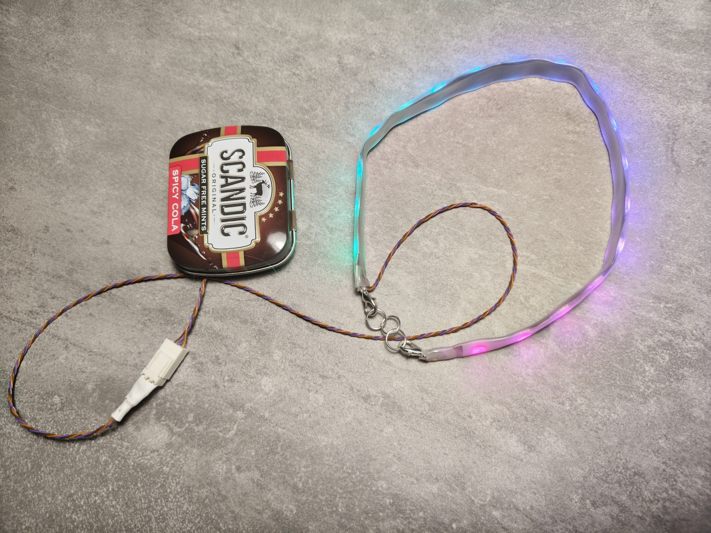
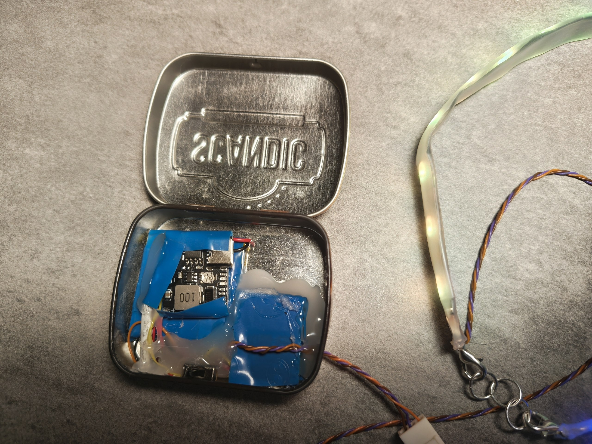

# LED choker

Светящийся чокер на адресных диодах с web-интерфейсом. Прошивка - полный вайбкод.

<table align="center">
  <tr>
    <td>
      <h3>Эффекты:</h3>
      <ul>
        <li>Rainbow</li>
        <li>Static color</li>
        <li>Breathing</li>
        <li>Confetti</li>
        <li>Fire</li>
        <li>Twinkle</li>
        <li>BPM</li>
        <li>Running Pixel</li>
        <li>Strobe</li>
        <li>Scanner</li>
      </ul>
    </td>
    <td width="300">
      
    </td>
    <td width="300">
      
    </td>
  </tr>
</table>

---

## Проект

<table align="center">
  <tr>
    <td>
      <h3 id="-">Используемые компоненты</h2>
        <ul>
        <li>ESP32-S3-zero</li>
        <li>Лента из 18 диодов WS2812B</li>
        <li>Двухпозиционный переключатель</li>
        <li>LX-LCBST (зарядка + повышайка)</li>
        <li>Аккумулятор 3.7в </li>
        </ul>
    </td>
    <td >
      
    </td>
  </tr>
</table>

  
  

## Необходимые компоненты 

1. Скачать [LittleFS](https://github.com/earlephilhower/arduino-littlefs-upload/releases/latest)

2. Установка плагина LittleFS Uploader (для Arduino IDE 2.2.1+)

    1. Скачайте файл плагина с расширением .vsix со страницы релизов LittleFS Uploader Plugin on GitHub.
    2. Поместите скачанный файл .vsix в специальную скрытую папку плагинов:
        - Windows: `C:\Users\<ваше_имя_пользователя>\.arduinoIDE\plugins\`
        - macOS: `~/.arduinoIDE/plugins/`
        - Linux: `~/.arduinoIDE/plugins/`
    3. Полностью закройте и перезапустите Arduino IDE.

3.  Загрузка LittleFS
    1. __Обязательно закройте Серийный монитор (Serial Monitor), иначе загрузка выдаст ошибку.__
    2. Нажмите комбинацию клавиш __Ctrl + Shift + P__ (в Windows/Linux) или __Cmd + Shift + P__ (в macOS), чтобы открыть командную строку.
    3. Введите и выберите команду: **Upload LittleFS to Pico/ESP8266/ESP32**.